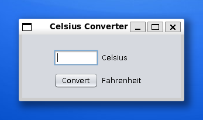

Portfolio
=========

Programming Projects
--------------------

*For access to my private project repositories, please [email me](mailto:example@csustudent.net?subject=GitHub%20Access) with the subject line, GitHub Access.

---
### [Project 1 Title | CSCI 301](project1)

---
### [Buddy Chat| CSCI 332](project2)

---
### [Project 3 Title | CSCI 325](project3)

---
### [Project 4 Title | CSCI 325](project4)

---

Ethics Papers
-------------

### [Scammers and Internet Ethics](/pdf/CSCI 325 ethics paper Rhett Cook.pdf)

-   **Class: CSCI 325 Object Oriented Programming**  
-   **Grade: A**

### [Regarding the Database](/pdf/Ethics paper CSCI419 Rhett Cook.pdf)

-   **Class: CSCI 419 Database Management** 
-   **Grade: A**

### [Coding Copyright and Ethics](/pdf/CSCI 301 paper Rhett Cook.pdf)

-   **Class: CSCI 301 Survey of Scripting Languages** 
-   **Grade: A**

---

Presentations
-------------

### [ALU in the Single Cycle Processor](/pdf/Untitled presentation.pdf)

- **Class: CSCI 330 Computer Architecture** 
- **Grade: A**

### [An Investigation of the Target Hack](/pdf/An Investigation of the Target Hack.pdf)

- **Class: CSCI 409 Principles of Cybersecurity** 
- **Grade: Not Yet Graded**

---

Page template forked from <a href="https://github.com/csu-cs/csci-portfolio">CSU-CS</a>

<!-- Remove above link if you don't want to attributive -->
