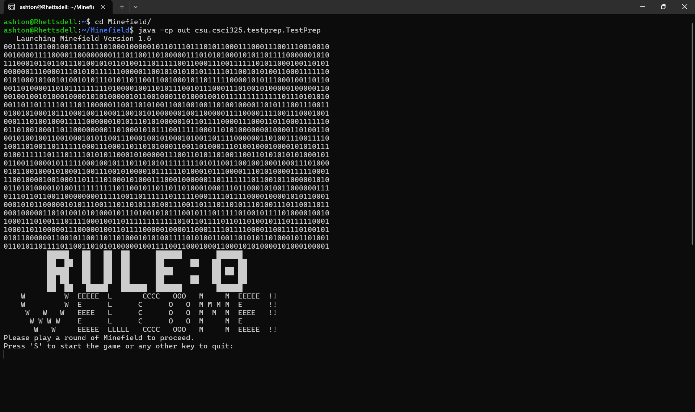
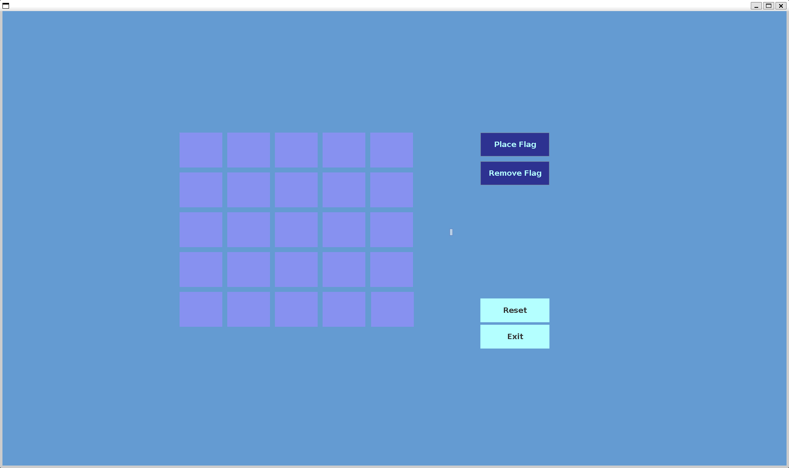
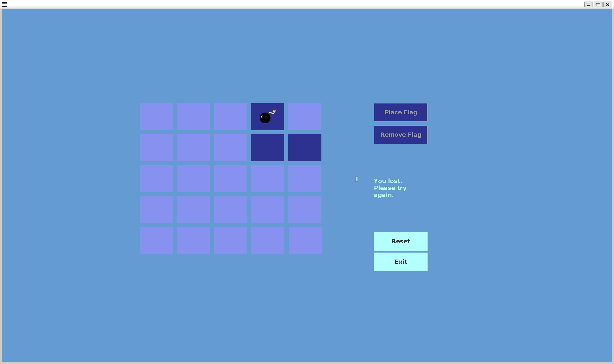
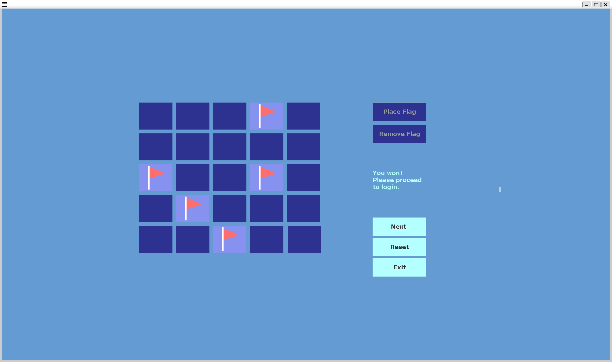
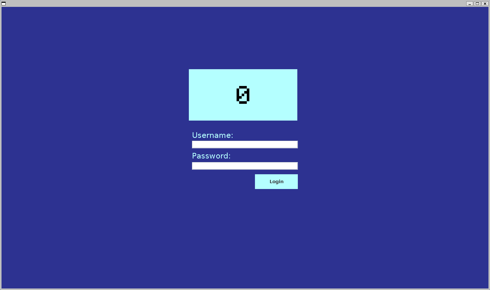
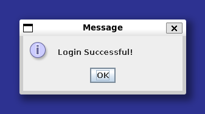

[Back to Portfolio](./)

Minefield
===============

-   **Class: CSCI 325** 
-   **Grade: A** 
-   **Language(s): Java** 
-   **Source Code Repository:** [Koisher/Minefield](https://github.com/Koisher/Minefield.git)  
    (Please [email me](mailto:ARCook@csustudent.net?subject=GitHub%20Access) to request access.)

## Project description

This project is a simulation of a game of minefield which, in this scenario, is supposed to mimic a captcha that prevents bots from reaching a sign in screen. This project was a final group project created for CSCI 325 Object Oriented programming.

## How to compile and run the program

```bash
java -cp out csu.csci325.testprep.TestPrep
```

## UI Design

When the user launches the program it plays a intro animation and asks the user to play a game of minefield to proceed (Fig 1).
Once the user confirms they would like to proceed the minefield game loads a seperate UI where the game is played (Fig 2).
After the user wins they are allowed to proceed to the sign in screen (Fig 5).
Finally, the user can input their credentials to sign in (Fig 6).

  
Fig 1. The launch screen.

  
Fig 2. Minefield screen.

  
Fig 3. Lose screen.

  
Fig 4. Victory screen.

  
Fig 5. Sign in screen once the game is won.

  
Fig 6. Screen after successful sign in.

[Back to Portfolio](./)
