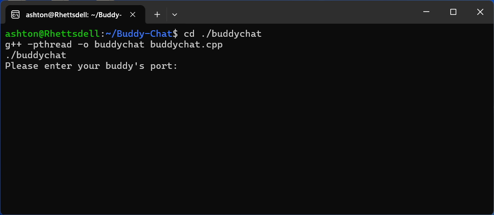
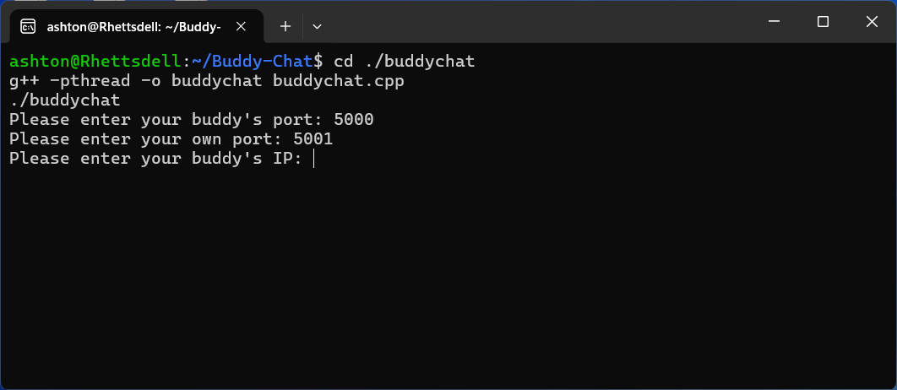
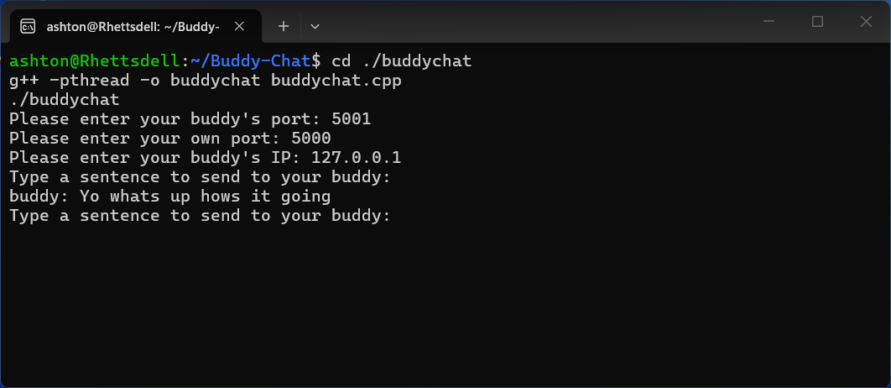

[Back to Portfolio](./)

Buddy Chat
===============

-   **Class: CSCI 332** 
-   **Grade: A** 
-   **Language(s): C++** 
-   **Source Code Repository:** [Koisher/Buddy-Chat](https://github.com/Koisher/Buddy-Chat.git)  
    (Please [email me](mailto:ARCook@csustudent.net?subject=GitHub%20Access) to request access.)

## Project description

A simple chat app created as a group project that allows the user to chat with another person who is using the program on a separate device.

## How to compile and run the program

```bash
cd ./buddychat
g++ -pthread -o buddychat buddychat.cpp
./buddychat
```

## UI Design

When you run the program you are asked to enter a port for your buddy then a port for yourself and finally an ip (Fig 1). 
Afterwards you are prompted to send a message to your buddy (Fig 2). Once you receive a message it will be displayed on your screen (Fig 3).

  
Fig 1. Prompt after launching the program.

  
Fig 2. Prompt asking for a message for your buddy.

  
Fig 3. Result of message received on client 2.

[Back to Portfolio](./)
