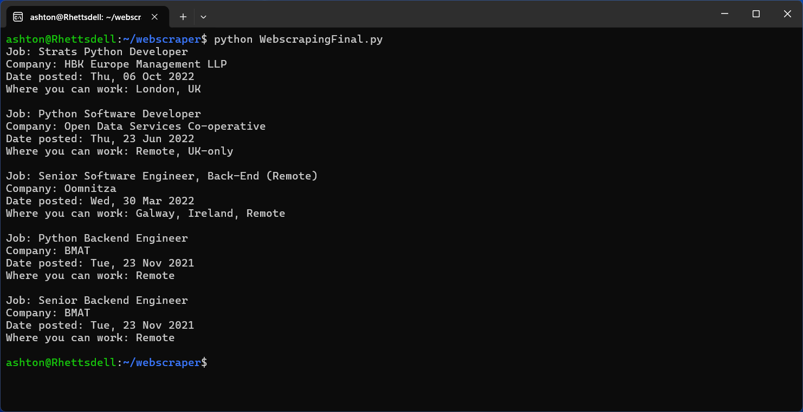

[Back to Portfolio](./)

Webscraper
===============

-   **Class: CSCI 301** 
-   **Grade: A** 
-   **Language(s): Python** 
-   **Source Code Repository:** [Koisher/webscraper](https://github.com/Koisher/webscraper.git/)  
    (Please [email me](mailto:ARCook@csustudent.net?subject=GitHub%20Access) to request access.)

## Project description

A basic python webscraper created as a final project for survey of scripting languages. The program obtains information from https://pythonjobs.github.io/ and displays it in a convenient format for the user.

## How to run the program

```bash
python WebscrapingFinal.py
```

## UI Design

When the program is run it immediately displays the information from the page (Fig 2).

  
Fig 1. Example [webpage](https://pythonjobs.github.io/) that information is being scraped from.

  
Fig 2. Results when the program is run.

[Back to Portfolio](./)
