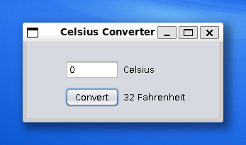

[Back to Portfolio](./)

Project 1 Title
===============

-   **Class: CSCI 325** 
-   **Grade: A** 
-   **Language(s): Java** 
-   **Source Code Repository:** [Koisher/Celcius-converter](https://github.com/Koisher/Celcius-converter.git)  
    (Please [email me](mailto:ARCook@csustudent.net?subject=GitHub%20Access) to request access.)

## Project description

This program provides a simple UI that allows the user to input any tempurature in Celcius to convert it to Fahrenheit.

## How to run the program

To get started with the app, clone the repo and then install the needed gems:

```
$ gem install bundler -v 2.3.14
$ bundle _2.3.14_ config set --local without 'production'
$ bundle _2.3.14_ install
```

Next, migrate the database:

```
$ rails db:migrate
```

If choosing to seed users for simulation:
```
$ rails db:migrate:reset
$ rails db:seed
```

Finally, run the test suite to verify that everything is working correctly:

```
$ rails test
```

If the test suite passes, you're ready to run the app in a local server:

```
$ rails server
```

## UI Design

After launching, the program allows the user to input any temperature in Celcius. After they click on the Convert button the  temperature will be calculated and displayed.

  
Fig 1. The launch screen.

  
Fig 2. Example output for 0.

  
Fig 3. Example output for a negative number.

[Back to Portfolio](./)