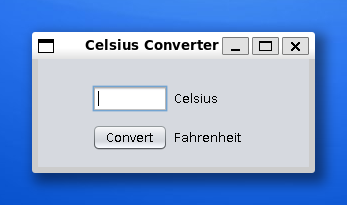
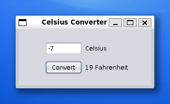

[Back to Portfolio](./)

Celcius Converter
===============

-   **Class: CSCI 325** 
-   **Grade: A** 
-   **Language(s): Java** 
-   **Source Code Repository:** [Koisher/Celcius-converter](https://github.com/Koisher/Celcius-converter.git)  
    (Please [email me](mailto:ARCook@csustudent.net?subject=GitHub%20Access) to request access.)

## Project description

This program provides a simple UI that allows the user to input any tempurature in Celcius to convert it to Fahrenheit.

## How to run the program

```
java -cp out learn.CelsiusConverterGUI
```


## UI Design

After launching, the program allows the user to input any temperature in Celcius (Fig 1). After they click on the Convert button the temperature will be calculated and displayed (Fig 2, Fig 3).

  
Fig 1. The launch screen.

  
Fig 2. Example output for 0.

  
Fig 3. Example output for a negative number.

[Back to Portfolio](./)
